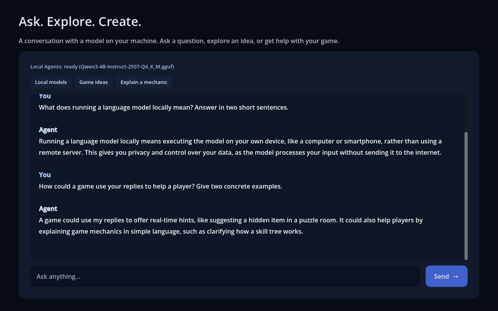
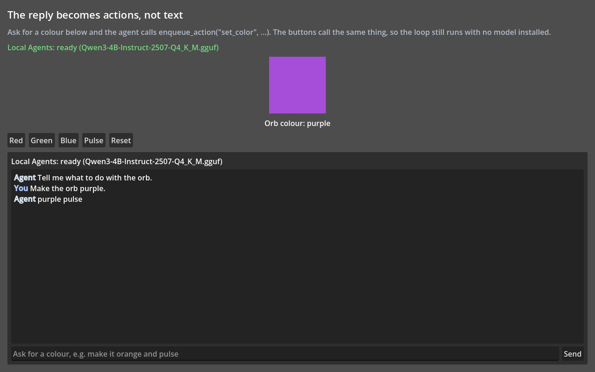
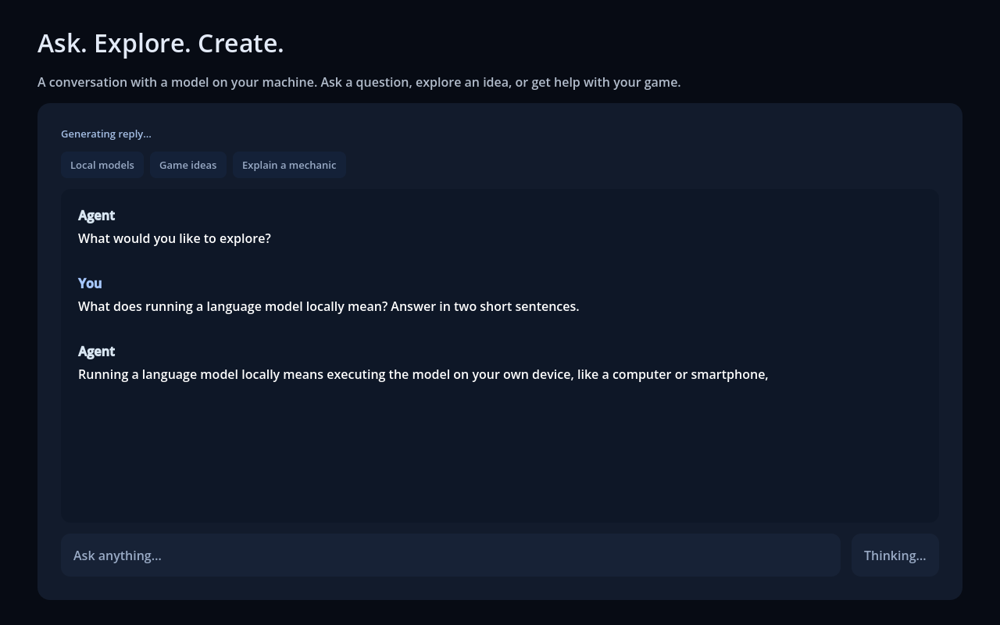
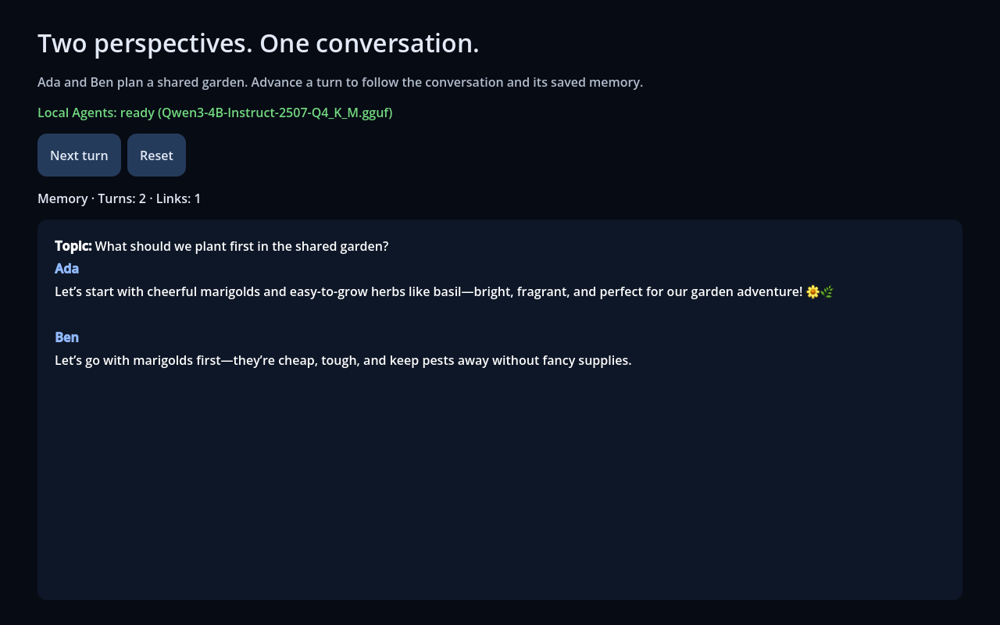
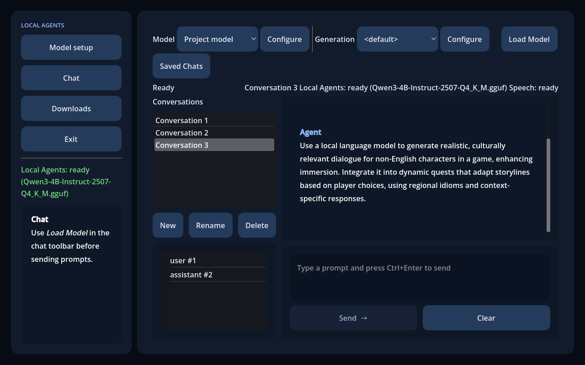

# Local Agents

Run a local language model in your Godot game. Generate dialogue, answer questions and turn replies
into game actions using [llama.cpp](https://github.com/ggml-org/llama.cpp). Inference stays on your machine.



*Captured from the development build. The status bar names the local model.*

## Try it

1. Install the native extension: build it below, or follow the
   [installation guide](addons/local_agents/docs/INSTALL.md) for prebuilt binaries.
2. Open the project in Godot and enable **Local Agents** in **Project Settings → Plugins**. Use the bottom panel to download
   a GGUF model or select one you already have.
3. Open `addons/local_agents/examples/DemoLauncher.tscn` and run **Agent Quickstart**. Type a question.

To play a packaged desktop demo, download a shipped build from
[Releases](https://github.com/adammikulis/local-agents/releases).

The native extension and a model are required. Source builds download both:

```bash
addons/local_agents/gdextensions/localagents/scripts/fetch_dependencies.sh
addons/local_agents/gdextensions/localagents/scripts/build_extension.sh --platform macos
```

Use `linux` or `windows` for those platforms. See [setup and usage](addons/local_agents/docs/USAGE.md)
for model configuration and integration details.

## Use it in a scene

Add a `LocalAgent` node, set its system prompt and connect its reply signal:

```gdscript
@onready var agent: LocalAgent = $LocalAgent

func _ready() -> void:
    agent.think_completed.connect(_on_reply)
    agent.think_async("Say hello in one sentence.")

func _on_reply(result: Dictionary) -> void:
    if result.get("ok", false):
        print(result["text"])
    else:
        push_warning(result.get("error", "agent unavailable"))
```

Replies stream through `reply_updated`; `think_completed` returns the final result. Use the bundled `ChatPanel` for a prompt box and transcript,
`action_requested` for game actions, and the memory graph for stored conversations.



*The prompt goes through the model; its reply drives the orb's colour.*

## Explore

Start with **Quickstart**, then **Actions**, **Conversation** and **Chat** in the demo launcher.
The [demo guide](addons/local_agents/docs/DEMOS.md) lists the examples and their requirements.

The [0.4 target](docs/0.4_RELEASE_SCOPE.md) is a stable, explorable planet for
[creatures and runtime cognition in 0.5](docs/ROADMAP_0.5.md).
[HANDOFF.md](HANDOFF.md) lists the remaining release work.

<details>
<summary>More live model screenshots</summary>

**Streaming:** a reply captured while generation was still running.



**Conversation:** two agents responding to each other.



**Chat:** saved conversations and model controls.



</details>

## Development

```bash
scripts/agent_harness.sh fast
scripts/agent_harness.sh lint
```

Read [CONTRIBUTING.md](CONTRIBUTING.md) for development setup and [CLAUDE.md](CLAUDE.md) for repository rules.
